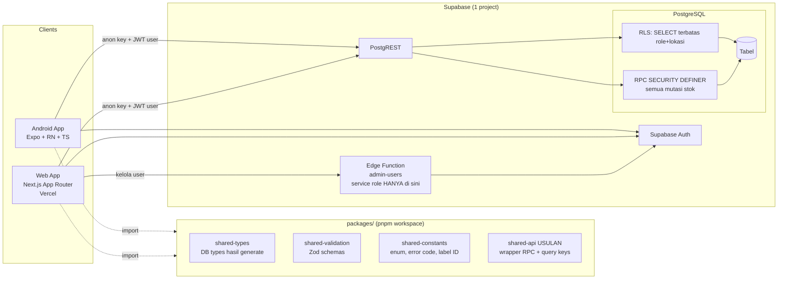
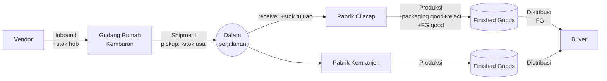
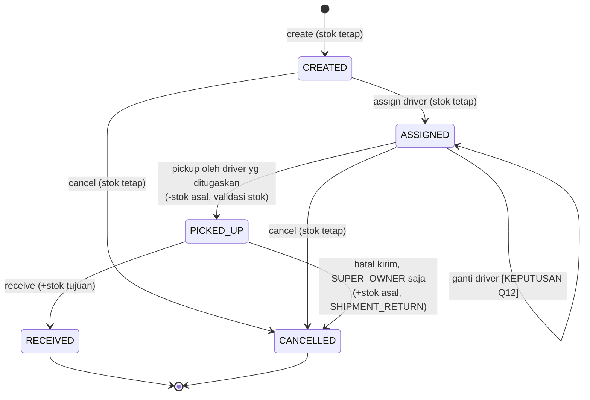

# Sasana Warehouse — Phase 0 Discovery

Status: **DRAFT rev 2: jawaban Q1–Q4, Q7, Q13, Q18 masuk (lihat §15)** · Tanggal: 2026-11-11
Schema SQL lengkap: [schema-draft.sql](schema-draft.sql)

Tanda yang dipakai dalam dokumen ini:
- **[KEPUTUSAN Qn]**: bergantung pada jawaban pertanyaan di §14.
- **[USULAN]**: rekomendasi saya. Belum menjadi aturan bisnis sampai disetujui.

---

## 1. Architecture Diagram



Prinsip:
1. **Baca**: client query tabel/view langsung. RLS membatasi baris sesuai role dan lokasi.
2. **Tulis transaksi** (inbound, shipment, produksi, distribusi): **hanya lewat RPC**. Client tidak punya grant INSERT/UPDATE/DELETE ke tabel transaksi dan stok.
3. **Tulis master data**: SUPER_OWNER memakai RLS policy, dan perubahan tercatat lewat trigger audit. **[USULAN]**
4. **Kelola user** (buat akun, reset password) butuh service role. Service role hanya ada di **Edge Function** yang memeriksa bahwa pemanggil adalah SUPER_OWNER.
5. Tidak ada server Express atau VPS. Web di Vercel memakai Supabase anon key saja.

**[USULAN] Tambahan package `packages/shared-api`.** Isinya fungsi seperti `pickupShipment(client, id)` dan `createInbound(client, input)`, plus query keys TanStack. Kedua app memanggil RPC yang sama dengan validasi Zod yang sama. Ini cara paling murah untuk menjaga Android dan web tetap konsisten (aturan #17).

---

## 2. Business Workflow Diagram



### Shipment state machine



Konsekuensi: antara PICKED_UP dan RECEIVED, barang **tidak tercatat di lokasi mana pun**. Stok dalam perjalanan (in-transit) dihitung dari `SUM(shipment_items.base_qty)` untuk shipment berstatus PICKED_UP. Angka ini ditampilkan di dashboard supaya total stok bisa direkonsiliasi.

### Ringkasan efek stok

| Transaksi | Lokasi | Item | Delta | Movement |
|---|---|---|---|---|
| Inbound | inbound hub | packaging | + base_qty | INBOUND |
| Shipment pickup | asal | per item | − base_qty | SHIPMENT_PICKUP |
| Shipment receive | tujuan | per item | + base_qty | SHIPMENT_RECEIVE |
| Produksi | pabrik | packaging utama | − (good + reject) | PRODUCTION_CONSUME |
| Produksi | pabrik | produk jadi | + good | PRODUCTION_RESULT |
| Distribusi | pabrik | produk jadi | − qty | DISTRIBUTION |
| Stok awal | lokasi mana pun | item apa pun | + qty fisik | OPENING_BALANCE |
| Penyesuaian | lokasi mana pun | item apa pun | ± (fisik − sistem) | ADJUSTMENT_IN / ADJUSTMENT_OUT |
| Void | sesuai transaksi asli | sesuai transaksi asli | kebalikan delta asli | VOID_REVERSAL |
| Batal kirim (PICKED_UP) | asal | per item | + base_qty | SHIPMENT_RETURN |

---

## 3. ERD

```mermaid
erDiagram
  AUTH_USERS ||--|| PROFILES : "1:1"
  PROFILES ||--o{ USER_LOCATIONS : assigned
  LOCATIONS ||--o{ USER_LOCATIONS : has
  ITEMS ||--o{ ITEM_UNITS : "satuan"
  ITEMS ||--o| PRODUCT_PACKAGINGS : "FG -> packaging"
  ITEMS ||--o{ PRODUCT_PACKAGINGS : "dipakai sbg packaging"
  ITEMS ||--o{ STOCKS : ""
  LOCATIONS ||--o{ STOCKS : ""
  ITEMS ||--o{ STOCK_MOVEMENTS : ""
  LOCATIONS ||--o{ STOCK_MOVEMENTS : ""
  VENDORS ||--o{ INBOUND_TRANSACTIONS : ""
  INBOUND_TRANSACTIONS ||--|{ INBOUND_ITEMS : ""
  SHIPMENTS ||--|{ SHIPMENT_ITEMS : ""
  PROFILES ||--o{ SHIPMENTS : "driver"
  LOCATIONS ||--o{ SHIPMENTS : "from/to"
  LOCATIONS ||--o{ PRODUCTIONS : ""
  ITEMS ||--o{ PRODUCTIONS : "FG + packaging snapshot"
  LOCATIONS ||--o{ DISTRIBUTIONS : ""
  ITEMS ||--o{ DISTRIBUTIONS : ""
  PROFILES ||--o{ AUDIT_LOGS : actor

  PROFILES { uuid id PK; text full_name; text email; user_role role; bool is_active }
  LOCATIONS { uuid id PK; text code UK; text name; location_type type; bool is_inbound_hub }
  ITEMS { uuid id PK; text sku UK; item_type type; text base_unit; bigint min_stock }
  ITEM_UNITS { uuid id PK; uuid item_id FK; text unit_name; int factor; bool is_base }
  STOCKS { uuid item_id PK; uuid location_id PK; bigint quantity }
  STOCK_MOVEMENTS { bigint id PK; uuid item_id; uuid location_id; bigint quantity_delta; bigint balance_after; movement_type type; text ref_type; uuid ref_id }
  SHIPMENTS { uuid id PK; text doc_no UK; shipment_status status; uuid driver_id; uuid idempotency_key UK }
  PRODUCTIONS { uuid id PK; bigint qty_good; bigint qty_reject; bigint packaging_consumed }
  DISTRIBUTIONS { uuid id PK; bigint base_qty; text buyer_name }
```

---

## 4. PostgreSQL Schema Draft: keputusan desain

Detail lengkap ada di [schema-draft.sql](schema-draft.sql). Keputusan penting:

| # | Keputusan | Alasan |
|---|---|---|
| D1 | Semua qty disimpan sebagai **integer base unit** (`bigint`) | Tidak ada pembulatan desimal. Konversi satuan hanya terjadi saat input. **[KEPUTUSAN Q5]** |
| D2 | `item_units` berlaku untuk **semua item**, bukan hanya produk jadi (prompt menyebut `product_units`) | Inbound packaging juga memakai satuan (mis. 1 bal = 1.000 pcs) |
| D3 | Baris transaksi menyimpan **snapshot** `unit_name`, `factor`, dan `packaging_item_id` | Jika konversi atau mapping packaging diubah nanti, riwayat lama tetap benar |
| D4 | `locations.is_inbound_hub` + partial unique index | "Inbound selalu ke gudang pusat" tanpa hardcode nama lokasi |
| D5 | `user_locations` (many-to-many) | Satu user bisa memegang lebih dari satu lokasi |
| D6 | `stocks.quantity CHECK (>= 0)` | No negative stock dijamin oleh database, tidak hanya oleh kode |
| D7 | `stock_movements` = ledger satu baris per perubahan saldo (delta bertanda + `balance_after`) | Riwayat bisa direkonsiliasi: `SUM(delta) = stocks.quantity` |
| D8 | `UNIQUE (ref_type, ref_id, movement_type, item_id)` di movements | Movement ganda untuk transaksi yang sama ditolak database |
| D9 | `idempotency_key UUID UNIQUE` di setiap header transaksi | Request yang dikirim ulang mengembalikan hasil transaksi pertama, bukan membuat transaksi baru |
| D10 | CHECK konsistensi status shipment (mis. RECEIVED → `received_at` wajib terisi) | Status tidak bisa "loncat" tanpa jejak |
| D11 | Transaksi tidak pernah di-DELETE, master data memakai `deleted_at` / `is_active` | Aturan #10 |
| D12 | Nomor dokumen `INB/SHP/PRD/DST-YYYYMM-0001` lewat `doc_counters` | Mudah dibaca operator. Periode memakai zona waktu Asia/Jakarta |
| D13 | Validasi tipe item (FINISHED_GOOD/PACKAGING) di RPC dan trigger | FK tidak bisa memeriksa kolom `type` |

### Pola RPC mutasi stok (concurrency-safe)

```text
rpc_pickup_shipment(p_shipment_id):
  1. uid := auth.uid(); profil harus aktif & role = DRIVER
  2. SELECT * FROM shipments WHERE id = p FOR UPDATE      -- kunci baris shipment
  3. jika status = PICKED_UP/RECEIVED dan picked_up_by = uid → return {ok, already_processed:true}  (retry aman)
  4. jika driver_id <> uid → raise FORBIDDEN
     jika status <> ASSIGNED → raise INVALID_STATUS
  5. FOR item IN shipment_items ORDER BY item_id           -- urutan tetap → hindari deadlock
       _apply_stock_delta(item, from_location, -base_qty, 'SHIPMENT_PICKUP', ...)
  6. UPDATE shipments SET status='PICKED_UP', picked_up_by=uid, picked_up_at=now()
  7. _audit(...)
  (seluruhnya 1 transaksi; error di langkah mana pun → rollback total)

_apply_stock_delta(item, loc, delta, ...):
  INSERT INTO stocks(item,loc,0) ON CONFLICT DO NOTHING
  UPDATE stocks SET quantity = quantity + delta WHERE ... RETURNING quantity   -- row lock implisit
  jika check_violation → raise INSUFFICIENT_STOCK (sertakan item & sisa stok)
  INSERT stock_movements(... balance_after = quantity baru)
```

Error dikembalikan dengan kode tetap (`INSUFFICIENT_STOCK`, `INVALID_STATUS`, `FORBIDDEN_LOCATION`, ...). `shared-constants` memetakan kode ke pesan Bahasa Indonesia.

---

## 5. Role Permission Matrix

Legenda: ✅ boleh · 📍 boleh, hanya untuk lokasi yang di-assign · 🚚 hanya shipment miliknya · ❌ tidak · ❓ menunggu keputusan

| Aksi | SUPER_OWNER | ADMIN_GUDANG | OWNER_PABRIK | DRIVER |
|---|---|---|---|---|
| Kelola user & assignment lokasi | ✅ | ❌ | ❌ | ❌ |
| Kelola lokasi, item, satuan, mapping packaging | ✅ | ❌ | ❌ | ❌ |
| Kelola vendor | ✅ | ❓ [Q15] | ❌ | ❌ |
| Lihat master data (item, lokasi, vendor) | ✅ | ✅ | ✅ | hanya item & lokasi di shipment miliknya |
| Buat inbound | ✅ | 📍 (harus di-assign ke hub) | ❌ | ❌ |
| Lihat inbound | ✅ | 📍 | ❌ | ❌ |
| Buat shipment | ✅ | 📍 (lokasi asal) | 📍 (asal = pabriknya) [Q4] | ❌ |
| Assign / ganti driver | ✅ | 📍 (lokasi asal) | 📍 (asal = pabriknya) | ❌ |
| Batal kirim shipment PICKED_UP | ✅ | ❌ | ❌ | ❌ |
| Input stok awal & penyesuaian | ✅ | ❌ | ❌ | ❌ |
| Void transaksi | ✅ | ❌ | ❌ | ❌ |
| Pickup | ❓ [Q12] | ❓ [Q12] | ❌ | 🚚 |
| Receive | ✅ | 📍 (lokasi tujuan) | 📍 (lokasi tujuan) | ❌ |
| Cancel shipment (CREATED/ASSIGNED) | ✅ | 📍 (lokasi asal) | ❌ | ❌ |
| Lihat shipment | ✅ | 📍 (asal atau tujuan) | 📍 (asal atau tujuan) | 🚚 |
| Input produksi | ❓ [Q10] | ❌ | 📍 | ❌ |
| Input distribusi | ❓ [Q10] | ❌ | 📍 | ❌ |
| Lihat stok | ✅ semua | 📍 ❓ [Q11] | 📍 | ❌ |
| Lihat stock movement | ✅ | 📍 | 📍 | ❌ |
| Dashboard | global | gudang + shipment | pabrik 📍 | daftar tugas |
| Laporan | ✅ semua | 📍 | 📍 | ❌ |
| Audit log | ✅ | ❌ | ❌ | ❌ |

Semua aksi juga mensyaratkan `profiles.is_active = true`. User nonaktif ditolak oleh RPC dan RLS meskipun JWT-nya masih berlaku.

---

## 6. RLS Strategy

**Helper functions** (`SECURITY DEFINER`, `STABLE`, `search_path = ''`):
- `app.current_role()`: role user aktif, atau NULL jika nonaktif.
- `app.is_super_owner()`
- `app.has_location(loc uuid)`: true jika SUPER_OWNER atau ada baris di `user_locations`.

Di dalam policy, panggil helper dalam bentuk `(select app.has_location(location_id))` dan `(select auth.uid())` supaya Postgres meng-cache hasilnya per query. Ini penting untuk performa.

| Tabel | SELECT | INSERT / UPDATE / DELETE dari client |
|---|---|---|
| profiles | diri sendiri. SUPER_OWNER semua. ADMIN_GUDANG: profil DRIVER aktif (untuk assign) | ❌ (Edge Function `admin-users`) |
| user_locations | diri sendiri. SUPER_OWNER semua | SUPER_OWNER |
| locations, items, item_units, product_packagings, vendors | semua user aktif (driver: lewat view shipment) | SUPER_OWNER (+ trigger audit) |
| stocks | `has_location(location_id)` | **❌ revoke total** |
| stock_movements | `has_location(location_id)` | **❌ revoke total** |
| inbound_transactions / items | `has_location(location_id)` & role ≠ DRIVER | ❌ (RPC) |
| shipments / shipment_items | SUPER_OWNER, `has_location(from)`, `has_location(to)`, atau `driver_id = uid` | ❌ (RPC) |
| productions, distributions | `has_location(location_id)` | ❌ (RPC) |
| audit_logs | SUPER_OWNER | ❌ (insert hanya dari RPC dan trigger) |
| doc_counters | ❌ | ❌ |

Aturan tambahan:
- `REVOKE ALL ON ALL TABLES FROM anon`. Role `anon` tidak bisa membaca apa pun.
- `REVOKE EXECUTE` fungsi internal (`_apply_stock_delta`, dll.) dari `public`, `anon`, dan `authenticated`. Hanya fungsi `rpc_*` yang di-GRANT ke `authenticated`.
- RLS adalah **lapisan baca**. Aturan bisnis (status, stok, role, lokasi) dicek ulang di dalam setiap RPC.
- Setiap policy dan RPC diuji dengan pgTAP (`supabase test db`) per role.

---

## 7. Daftar Screen Android

Prinsip: maksimal 3 tap untuk transaksi rutin. Setiap aksi yang mengubah stok menampilkan bottom-sheet konfirmasi berisi ringkasan qty. Banner koneksi selalu tampil saat offline.

**Umum**
| Screen | Keterangan |
|---|---|
| Splash / Session check | redirect sesuai role |
| Login | email + password **[KEPUTUSAN Q13]** |
| Akun nonaktif | pesan + logout |
| Profil | nama, role, lokasi, ganti password, logout |
| Hasil transaksi | sukses/gagal + no. dokumen |

**DRIVER** (dibuat sesederhana mungkin)
| Screen | Keterangan |
|---|---|
| Tugas Saya | kartu besar: ASSIGNED (siap pickup) & PICKED_UP (dalam perjalanan) |
| Detail Tugas | asal → tujuan, daftar barang + qty, tombol **Pickup** besar |
| Konfirmasi Pickup | ringkasan barang → konfirmasi |
| Riwayat Tugas | shipment selesai, filter tanggal |

**ADMIN_GUDANG**
| Screen | Keterangan |
|---|---|
| Dashboard Gudang | stok packaging, low stock, shipment per status |
| Inbound: daftar / buat / detail | form: vendor → tambah item (item, satuan, qty) → konfirmasi |
| Shipment: daftar (tab status) / buat / detail | detail punya aksi Assign Driver, Receive, Cancel sesuai status & izin |
| Pilih Driver | list driver aktif + jumlah tugas aktif |
| Stok: daftar / detail item | filter tipe, pencarian; detail berisi riwayat movement |

**OWNER_PABRIK**
| Screen | Keterangan |
|---|---|
| Dashboard Pabrik | stok packaging & FG, produksi hari ini/bulan ini, reject, distribusi, low stock |
| Shipment Masuk + Receive | daftar PICKED_UP menuju pabriknya |
| Produksi: daftar / input / detail | input: produk → good → reject → tanggal → konfirmasi (tampilkan packaging yang akan terpakai & sisa stok) |
| Distribusi: daftar / input / detail | produk → satuan & qty → buyer → konfirmasi |
| Stok: daftar / detail item | |

**SUPER_OWNER** (Android untuk monitoring + transaksi darurat)
Dashboard Global, Stok semua lokasi, Shipment semua, Produksi & Distribusi (read). Master data dan user dikelola di web.

---

## 8. Daftar Screen Web

| Route | Screen | Role |
|---|---|---|
| `/login` | Login | semua |
| `/` | Dashboard (konten sesuai role) | semua kecuali DRIVER |
| `/inbound`, `/inbound/new`, `/inbound/[id]` | Inbound | SO, AG |
| `/shipments`, `/shipments/new`, `/shipments/[id]` | Shipment + assign/receive/cancel | SO, AG, OP |
| `/stock` | Stok per lokasi (matrix item × lokasi), low stock | SO, AG, OP |
| `/stock/[itemId]` | Detail item: saldo per lokasi + movement | SO, AG, OP |
| `/movements` | Riwayat stock movement (filter item/lokasi/tipe/periode) | SO, AG, OP |
| `/production`, `/production/new`, `/production/[id]` | Produksi | SO, OP |
| `/distribution`, `/distribution/new`, `/distribution/[id]` | Distribusi | SO, OP |
| `/reports` | Laporan: stok, inbound, shipment, produksi, reject, distribusi, traceability; export CSV | SO, AG, OP |
| `/master/locations` | Lokasi | SO |
| `/master/items`, `/master/items/[id]` | Item + tab Satuan + tab Packaging utama | SO |
| `/master/vendors` | Vendor | SO (+AG ❓) |
| `/users`, `/users/[id]` | User, role, lokasi, aktif/nonaktif | SO |
| `/audit-logs` | Audit log | SO |
| `/profile` | Profil | semua |

DRIVER yang login di web diarahkan ke halaman "Gunakan aplikasi Android" dan daftar tugas read-only.

---

## 9. Navigation Structure

**Android (Expo Router)**
```text
app/
  _layout.tsx               # QueryClientProvider, AuthProvider, ConnectionBanner
  index.tsx                 # redirect berdasarkan session + role
  (auth)/login.tsx
  (driver)/_layout.tsx      # Tabs: Tugas | Riwayat | Profil
    tasks/index.tsx, tasks/[id].tsx, history.tsx, profile.tsx
  (warehouse)/_layout.tsx   # Tabs: Beranda | Inbound | Shipment | Stok | Profil
    index.tsx, inbound/{index,new,[id]}.tsx, shipments/{index,new,[id]}.tsx, stock/{index,[itemId]}.tsx
  (factory)/_layout.tsx     # Tabs: Beranda | Produksi | Distribusi | Stok | Lainnya(Shipment masuk, Profil)
  (owner)/_layout.tsx       # Tabs: Beranda | Stok | Shipment | Laporan | Profil
```
Setiap group layout memeriksa role. Jika tidak cocok, user di-redirect. Ini hanya untuk UX. Keamanan tetap di database.

**Web (Next.js App Router)**
```text
app/
  (auth)/login/page.tsx
  (dashboard)/layout.tsx    # Sidebar menu difilter role, header lokasi aktif, middleware cek session
    page.tsx, inbound/..., shipments/..., stock/..., movements/..., production/...,
    distribution/..., reports/..., master/..., users/..., audit-logs/..., profile/...
middleware.ts               # refresh session (@supabase/ssr), redirect ke /login
```

---

## 10. Monorepo Folder Structure

```text
sasana-warehouse/
  apps/
    mobile/                   # Expo (Android)
      app/                    # routes (UI saja)
      src/components/  src/features/<modul>/{components,hooks}/  src/lib/supabase.ts
    web/                      # Next.js
      app/                    # routes
      src/components/ui/      # shadcn
      src/features/<modul>/{components,hooks}/  src/lib/supabase/{client,server}.ts
  packages/
    shared-types/             # database.types.ts (supabase gen types) + domain types
    shared-validation/        # Zod: inbound, shipment, production, distribution, master
    shared-constants/         # enum, label status, warna status, kode error → pesan ID
    shared-api/               # [USULAN] wrapper RPC & query, query keys
  supabase/
    config.toml
    migrations/               # 0001_enums.sql, 0002_master.sql, 0003_stock.sql, ...
    functions/admin-users/    # Edge Function (service role)
    tests/                    # pgTAP: rpc_*.test.sql, rls_*.test.sql
    seed.sql                  # lokasi, item, satuan, mapping awal (TANPA user/password)
  docs/
    phase-0/  modules/  runbooks/
  .env.example                # hanya nama variabel, tanpa nilai rahasia
  pnpm-workspace.yaml  package.json  tsconfig.base.json  .npmrc
```
Batas lapisan: `app/` (UI routing) → `features/*/hooks` (TanStack Query) → `shared-api` (pemanggilan Supabase) → RPC di database (business logic). Shared packages **tidak** bergantung pada React, supaya tidak bentrok versi React antara Expo dan Next.js.

---

## 11. Security Architecture

| Lapisan | Kontrol |
|---|---|
| Secrets | Client hanya memegang `SUPABASE_URL` + `ANON_KEY`. Service role hanya di secrets Edge Function. `.env*` masuk `.gitignore`, `.env.example` tanpa nilai |
| Auth | Supabase Auth. Public signup **dimatikan**, user hanya dibuat oleh SUPER_OWNER via Edge Function. Session Android di `expo-sqlite/localStorage` (sandbox aplikasi; rekomendasi resmi Expo SDK 58). Web memakai cookie `@supabase/ssr` |
| Nonaktifkan user | `profiles.is_active=false` langsung memblokir RPC dan RLS. Edge Function juga mem-ban user di Auth agar refresh token berhenti berlaku |
| Authorization | RLS untuk baca. RPC memeriksa role, lokasi, status, dan stok untuk setiap tulis |
| Integritas stok | CHECK `>= 0`, row lock, urutan lock tetap, satu transaksi DB per operasi, unique movement, rekonsiliasi `SUM(delta)` (dijalankan di test & bisa dipakai sebagai health check) |
| Idempotency | Client membuat `idempotency_key` (UUID) **sekali per form** dan memakainya ulang saat retry. Transisi status (pickup/receive) idempotent per user |
| Online-first | Tombol submit dinonaktifkan saat offline. Timeout memunculkan status "tidak pasti" dengan tombol "Cek / Kirim ulang" yang memakai key yang sama. UI baru menampilkan sukses setelah RPC mengembalikan hasil |
| Audit | Setiap RPC dan perubahan master data menulis ke `audit_logs` (append-only, tanpa grant update/delete) |
| SECURITY DEFINER | Selalu `SET search_path = ''`, nama tabel ditulis lengkap dengan schema, owner = postgres, revoke dari `public` |
| Supabase linter | `supabase db lint` + Security Advisor wajib bersih sebelum rilis |

---

## 12. Implementation Roadmap

| Phase | Deliverable | Kriteria selesai (harus teruji) |
|---|---|---|
| 0 Discovery | Dokumen ini | Disetujui, pertanyaan §14 terjawab |
| 1 Foundation | Monorepo pnpm, Expo, Next.js, shared packages, Supabase local, migration enums + profiles + locations, Auth login/logout di kedua app, theme & komponen dasar, connection banner | Login berhasil di emulator Android & browser; role redirect benar; lint + typecheck lulus |
| 2 Master Data | Locations, items, item_units, product_packagings, vendors, user management (Edge Function), audit trigger | pgTAP RLS master lulus; CRUD master di web; seed produk awal |
| 3 Stock & Inbound | stocks, stock_movements, `_apply_stock_delta`, `rpc_create_inbound`, layar stok + low stock + movement | Test: inbound menambah stok, retry tidak menggandakan, user tanpa izin ditolak |
| 4 Shipment | create/assign/pickup/receive/cancel RPC, layar driver | Test: stok kurang → pickup gagal; pickup 2× tidak menggandakan; concurrent pickup dua shipment yang sama-sama mengambil stok terakhir → hanya satu yang berhasil |
| 5 Production | `rpc_create_production` + layar | Test: konsumsi = good + reject, rollback saat packaging kurang, mapping snapshot |
| 6 Distribution | `rpc_create_distribution` + layar | Test: hanya FG, buyer wajib, stok tidak minus, packaging tidak tersentuh |
| 7 Dashboard & Report | `rpc_dashboard_summary`, laporan, traceability, export CSV | Angka dashboard = query manual pada data uji |
| 8 Testing & Release | Suite pgTAP lengkap, test unit Zod, uji perangkat Android asli, APK (EAS/local build), deploy Vercel, dokumentasi | Checklist rilis lengkap |

Setiap phase berakhir dengan: daftar file yang dibuat, cara menjalankan, hasil test. Saya berhenti dan menunggu persetujuan sebelum lanjut ke phase berikutnya.

---

## 13. Risiko Teknis

| # | Risiko | Dampak | Mitigasi |
|---|---|---|---|
| R1 | Supabase Free Tier: project **di-pause** setelah ±7 hari tanpa aktivitas, **tanpa backup harian** | Operasional berhenti / data stok hilang | Pakai Pro saat go-live, atau minimal `pg_dump` terjadwal. **[KEPUTUSAN Q18]** |
| R2 | Expo + pnpm monorepo (Metro & symlink) | Build gagal | `.npmrc node-linker=hoisted`, ikuti panduan monorepo Expo SDK terbaru |
| R3 | Versi React berbeda antara Expo dan Next.js | Konflik dependency | Shared packages bebas React. Versi React dikunci per app |
| R4 | Salah konfigurasi SECURITY DEFINER | Bypass RLS | Template fungsi baku, revoke default, test pgTAP per role, Security Advisor |
| R5 | Deadlock / race condition stok | Transaksi gagal / stok salah | Lock berurutan `item_id`, satu transaksi DB, test concurrent |
| R6 | Belum ada mekanisme **stok awal & koreksi** | Saldo awal tidak bisa diinput, kesalahan input tidak bisa diperbaiki tanpa delete | Perlu keputusan **Q1, Q2** sebelum Phase 3 |
| R7 | Barang "hilang" saat PICKED_UP tanpa jalur pembatalan / selisih | Stok tidak terekonsiliasi | Laporan in-transit + keputusan **Q3** |
| R8 | Sinyal lemah di lokasi pabrik/driver | User frustrasi, double submit | Idempotency key, status "tidak pasti" + cek ulang, payload kecil |
| R9 | Perubahan konversi / mapping packaging setelah ada transaksi | Riwayat salah | Snapshot di baris transaksi (D3) |
| R10 | Zona waktu (UTC vs WIB) | Laporan "hari ini" bergeser | Simpan `timestamptz`, agregasi `AT TIME ZONE 'Asia/Jakarta'` |
| R11 | Driver tidak punya email / akun dipakai bersama | Audit tidak akurat | **[KEPUTUSAN Q13]** |
| R12 | Supabase CLI lokal butuh Docker Desktop di Windows | Tidak bisa test DB lokal | Pasang Docker Desktop, atau gunakan project Supabase dev terpisah |
| R13 | "Membangun ulang": ada data sistem lama? | Perlu migrasi data | **[KEPUTUSAN Q17]** |
| R14 | Dua frontend = beban kerja ganda | Fitur tidak konsisten | `shared-api` + `shared-validation`. Fitur dianggap selesai hanya jika ada di kedua app |
| R15 | APK build: antrian EAS free tier lambat | Rilis tertunda | Build lokal (`expo run:android` / Gradle) sebagai cadangan |

---

## 14. Pertanyaan yang Membutuhkan Keputusan Anda

Diurutkan dari yang paling berdampak ke stok. Tiap pertanyaan menyebut phase yang terblokir dan usulan default saya.

**Berdampak langsung ke stok**

- **Q1. Stok awal (opening balance).** Saat go-live, stok yang sudah ada di gudang dan pabrik diinput dengan cara apa?
  *Usulan:* fitur "Stok Awal / Penyesuaian" khusus SUPER_OWNER, movement `OPENING_BALANCE`, wajib isi alasan. *Blok: Phase 3.*
- **Q2. Koreksi kesalahan input** (qty inbound salah, produksi salah ketik). Transaksi tidak boleh di-delete. Bagaimana memperbaikinya?
  *Usulan:* SUPER_OWNER dapat **membatalkan (void)** transaksi dengan alasan. Sistem membuat movement pembalik, dan pembatalan ditolak jika stok sudah terpakai. Untuk selisih fisik dipakai stock opname (`ADJUSTMENT_IN/OUT`). *Blok: Phase 3.*
- **Q3. Shipment setelah PICKED_UP** gagal sampai, rusak, atau jumlah yang datang kurang. Apa yang terjadi?
  *Usulan MVP:* receive selalu penuh. Selisih dicatat sesudahnya lewat adjustment di lokasi tujuan. SUPER_OWNER boleh "batal kirim" shipment PICKED_UP, dan stok kembali ke asal (`SHIPMENT_RETURN`). *Blok: Phase 4.*
- **Q4. Cakupan shipment.** Apakah shipment hanya untuk PACKAGING dari Gudang Rumah? Atau juga antar pabrik, pabrik → gudang (retur packaging), atau memindahkan finished goods?
  *Usulan:* item apa pun, dari lokasi mana pun ke mana pun, dibuat oleh SO/AG. *Blok: Phase 4.*
- **Q5. Qty selalu bilangan bulat** dalam base unit (sachet, pcs, botol)? Tidak ada packaging dalam kg/meter (mis. roll plastik)? *Blok: Phase 2.*
- **Q6. Satuan packaging.** Apakah packaging diterima dari vendor dalam satuan besar (bal, roll, karton) yang perlu dikonversi? *Usulan:* ya, `item_units` dipakai untuk semua item. *Blok: Phase 2.*
- **Q7. Rasio packaging.** Apakah 1 unit produk jadi = tepat 1 unit packaging utama? Bagaimana dengan Herbal SN 100 g, yang mungkin dihitung per pouch dan bukan per sachet? Dus atau renteng luar tidak ikut dikurangi di MVP? *Blok: Phase 5.*
- **Q8. Produk per pabrik.** Apakah sistem harus **menolak** produksi produk di pabrik yang bukan tempatnya (mis. Monster Pro di Kemranjen)? *Usulan:* ya, lewat master "produk yang boleh diproduksi per lokasi". *Blok: Phase 5.*
- **Q9. Minimum stock** berlaku global per item (satu angka untuk semua lokasi) atau per item per lokasi? *Usulan:* per item dulu, sesuai prompt. *Blok: Phase 3.*

**Hak akses**

- **Q10.** Apakah SUPER_OWNER boleh **input** produksi dan distribusi, atau hanya melihat?
- **Q11.** ADMIN_GUDANG melihat stok **hanya lokasi yang di-assign**, atau stok packaging di **semua lokasi** (untuk merencanakan pengiriman)? *Usulan:* boleh melihat stok packaging semua lokasi (read-only).
- **Q12.** Driver: (a) Boleh ganti atau lepas driver saat status ASSIGNED? (b) Jika driver berhalangan, boleh ADMIN_GUDANG/SUPER_OWNER melakukan pickup atas nama driver? *Usulan:* (a) ya, (b) tidak di MVP.
- **Q13.** Login driver dan operator memakai **email asli**? Jika banyak yang tidak punya email, usulan saya: username → email sintetis (`budi@sasana.local`), password diset oleh SUPER_OWNER, satu akun per orang.
- **Q14.** Buyer distribusi cukup **teks bebas**, atau perlu master buyer (untuk laporan per buyer yang konsisten)?
- **Q15.** Siapa yang boleh mengelola vendor? Vendor wajib dipilih di inbound?

**Operasional & infrastruktur**

- **Q16.** Tanggal transaksi boleh **mundur (backdate)**? Jika ya, maksimal berapa hari?
- **Q17.** Apakah ada **data sistem lama** (master item, stok, riwayat) yang perlu dimigrasi? Dalam format apa (Excel, database lain)?
- **Q18.** Supabase plan: Free (risiko pause dan tanpa backup) atau Pro saat go-live? Region **Singapore** (latensi terendah dari Indonesia) disetujui?
- **Q19.** Konfirmasi ulang daftar produk dan packaging utamanya (selain Dopping Dewa = botol). Boleh dikirim nanti sebelum Phase 2 sebagai bahan `seed.sql`.
- **Q20.** Apakah distribusi juga bisa dari Gudang Rumah, atau hanya dari pabrik?

---

## 15. Decision Log (rev 2)

| Q | Jawaban owner | Implementasi |
|---|---|---|
| Q1 | Stok awal diinput oleh owner/developer dari cek fisik per gudang saat go-live | Layar **Stok Awal** (web), khusus SUPER_OWNER. Input per lokasi, bisa import CSV. Hanya diterima jika item+lokasi belum punya movement; setelah itu koreksi lewat Penyesuaian. Akun developer = user SUPER_OWNER biasa, tanpa akses khusus |
| Q2 | Boleh memakai fitur Void | `rpc_void_transaction`, khusus SUPER_OWNER, alasan wajib. Berlaku untuk inbound, produksi, distribusi, dan penyesuaian. Ditolak jika stok hasil transaksi sudah terpakai. Shipment memakai Cancel, bukan Void. Shipment RECEIVED tidak bisa di-void; koreksinya lewat shipment balik atau penyesuaian **[USULAN]** |
| Q3 | Fitur disetujui | Receive selalu penuh. Selisih/rusak dicatat lewat **Penyesuaian** di lokasi tujuan. SUPER_OWNER boleh membatalkan shipment PICKED_UP dan stok kembali ke asal (`SHIPMENT_RETURN`) |
| Q4 | Shipment untuk: (1) packaging gudang → pabrik, (2) FG pabrik → Gudang Penjualan, (3) pabrik → lokasi tertentu, dengan catatan FG tetap tercatat larinya ke mana | Shipment boleh berisi PACKAGING maupun FINISHED_GOOD. Tipe lokasi baru `SALES_WAREHOUSE`. OWNER_PABRIK boleh membuat shipment dan assign driver dari pabriknya. **Poin (3) menunggu Q4a–Q4c** |
| Q7 | 1 produk jadi = 1 unit packaging utama | Konsumsi = good + reject, rasio 1:1 |
| Q13 | Pilih login paling mudah | **Username + password.** Supabase Auth memakai email sintetis `<username>@users.sasana.internal`, user tidak pernah melihatnya. Akun dibuat SUPER_OWNER, password direset SUPER_OWNER. Tanpa verifikasi email atau OTP SMS (OTP SMS berbayar) |
| Hosting | Tetap Supabase (bukan VPS); web di Cloudflare karena Vercel Hobby non-komersial | Supabase Free + Cloudflare Pages/Workers (Next.js via OpenNext). Biaya Rp 0/bulan. Akses `auth.uid()` dibungkus helper agar tetap portable ke Postgres VPS jika kelak pindah. Upgrade ke Pro saat DB mendekati 500 MB atau butuh PITR/staging |
| Q18 | Supabase Free dulu | Mitigasi R1: GitHub Actions terjadwal (1) `pg_dump` harian disimpan sebagai artifact/private storage, (2) query ringan berkala agar project tidak di-pause. Dibuat di Phase 1 |

| Q6 | Packaging diterima dari vendor, admin input per sachet saja | Item PACKAGING hanya punya satuan dasar (sachet/botol/karton); tidak ada konversi untuk inbound |
| Q14 | Buyer disimpan di database agar tidak duplikat | Tabel `buyers`, nama unik (tidak case-sensitive). Dikelola SO, Admin Gudang, Owner Pabrik **[USULAN: sama dengan vendor]** |
| Q15 | Vendor dikelola Super Owner, Owner Pabrik, Admin Gudang | Tabel `vendors`, nama unik; RLS insert/update untuk ketiga role; tanpa hapus (nonaktifkan) |
| Q19 | Daftar produk dari `seed.js` sistem lama | Migration `20261112000200_master_data_initial.sql`: 15 packaging, 15 produk jadi, mapping 1:1, konversi renteng/dus. User & stok dummy dari seed lama **tidak** diambil |
| Q20 | Distribusi utama dari Gudang Penjualan | Lokasi `GPJ-KMB` Gudang Penjualan Kembaran (SALES_WAREHOUSE) |
| Q21 | Distribusi di Gudang Penjualan diinput Admin Gudang | ADMIN_GUDANG boleh input distribusi di lokasi yang di-assign (Phase 6). Buyer dikelola SO/AG/OP: dikonfirmasi |
| Q8 | Produksi tidak boleh lintas pabrik. Kemranjen: Herbal SN 35/100, Dragon SN, Bima Power, Dopping Dewa, Dragon Merpati; lainnya Cilacap; bisa diubah | Tabel `product_locations` (migration `20261112000300`), diatur Super Owner di halaman detail produk. Dipakai validasi produksi (Phase 5) |
| Q9 | Minimum stok fleksibel, default 100 sachet | Default `items.min_stock` = 100 (satuan dasar), dapat diubah per barang. Status "Menipis" bila stok < minimum |
| Q16 | Tanggal transaksi boleh mundur maksimal 1 minggu | `app.assert_transaction_date`: maksimal 7 hari ke belakang, tidak boleh masa depan (WIB). Berlaku untuk inbound, stok awal/penyesuaian, dan transaksi berikutnya |

**Asumsi yang saya pakai sampai Anda koreksi:**
- **Q5:** qty selalu bilangan bulat dalam base unit.
- **Q17:** tidak ada migrasi data lama. Sistem mulai dari stok awal hasil cek fisik (Q1), tanpa riwayat lama.

### Pertanyaan lanjutan Q4 (berdampak ke stok, memblokir Phase 4)

- **Q4a. "Lokasi tertentu" itu apa?**
  - **Opsi A:** lokasi luar (agen, toko, buyer) yang **tidak dilacak stoknya**. Barang keluar dari stok sistem, dan tujuannya tercatat sebagai master lokasi bertipe `EXTERNAL`. Riwayat "lari ke mana" bisa dilaporkan.
  - **Opsi B:** lokasi internal milik usaha yang stoknya **ikut dilacak**, seperti gudang.
  - **Usulan saya:** Opsi A, karena sesuai catatan "tercatat larinya ke mana".
- **Q4b. Jika Opsi A, siapa yang mengonfirmasi barang sampai?** Di lokasi luar tidak ada user aplikasi.
  - **Usulan:** driver menekan "Terkirim", lalu status menjadi DELIVERED. Ini pengecualian dari aturan "driver tidak boleh receive", dan hanya berlaku untuk tujuan EXTERNAL.
- **Q4c. Apa bedanya pengiriman ke lokasi luar dengan modul Distribusi?**
  - **Usulan:** Distribusi = penjualan yang langsung keluar dari pabrik, tanpa driver sistem. Shipment ke EXTERNAL = pengiriman memakai driver. Keduanya tampil bersama di laporan "FG keluar per tujuan".

### Pertanyaan yang belum dijawab (tidak memblokir Phase 1)

Q6, Q8, Q9, Q10, Q11, Q12, Q14, Q15, Q16, Q19, Q20 (lihat §14).

---

**Langkah berikutnya:** setelah Anda menyetujui dokumen ini dan menjawab Q1–Q20 (minimal Q5, Q13, Q17, Q18 untuk memulai Phase 1–2), saya mulai **Phase 1 — Foundation**. Kode aplikasi belum dibuat sama sekali.
